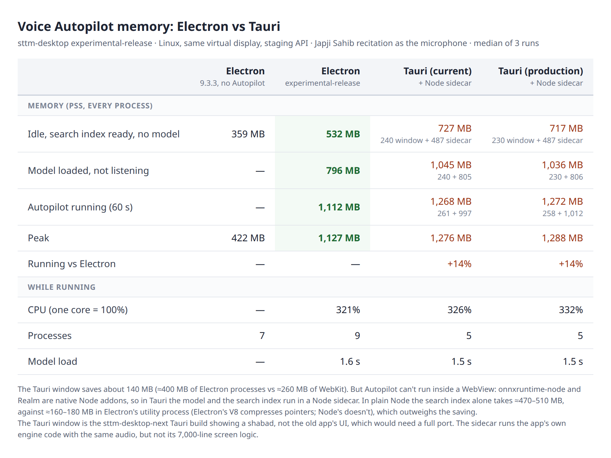

# Voice Autopilot memory: Electron vs Tauri

Does moving the desktop app to Tauri reduce how much memory Voice Autopilot uses? **No.**

The Tauri window is about 140 MB lighter than Electron's. But Autopilot can't run in a WebView, so it has to run in a Node sidecar, and there it uses about 300 MB more than inside Electron. While Autopilot runs, Electron uses 1,112 MB and Tauri with the sidecar uses about 1,270 MB, which is 14% more.

Measured 18 Nov 2026 on `experimental-release` (a0a47fee).



## Numbers

PSS summed over every process, in MB, median of 3 runs.

| | Electron 9.3.3 (no Autopilot) | Electron experimental-release | Tauri current + sidecar | Tauri production + sidecar |
|---|---:|---:|---:|---:|
| Idle: search index ready, no model | 359 | **532** | 727 (240 + 487) | 717 (230 + 487) |
| Model loaded, not listening | — | **796** | 1,045 (240 + 805) | 1,036 (230 + 806) |
| Autopilot running, 60 s | — | **1,112** | 1,268 (261 + 997) | 1,272 (258 + 1,012) |
| Peak | 422 | **1,127** | 1,276 | 1,288 |
| CPU while running (one core = 100%) | — | 321% | 326% | 332% |
| Processes | 7 | 9 | 5 | 5 |
| Model load (ONNX session + self-test) | — | 1.6 s | 1.5 s | 1.5 s |

For Tauri, each cell reads window + sidecar. The models run at the same speed in all builds: about 110 ms per 4 s window, about 5 passes a second.

## Where the memory goes

Electron, while running (run 2):
- The presenter renderer is 634 MB. At idle it is 103 MB, so about 530 MB of that is the engine: the 184 MB int8 CTC model with ONNX Runtime's buffers, plus YAMNet (16 MB) and the audio buffers.
- The retrieval utility process is 179 MB. It holds a text index of 142,576 pangtis, read from Realm.
- The rest is about 400 MB: the main process (80), the viewer (115), the GPU process (43), network (20), audio (15) and the zygotes (20).

Tauri production, while running:
- The window is 258 MB: tauri (64), WebKitWebProcess (166) and WebKitNetworkProcess (27).
- The sidecar holds the engine (485 MB) and the retrieval child process (512 MB).

So the window is about 140 MB smaller, and the engine costs about the same in both. The difference is the retrieval index. It takes 470–630 MB in plain Node and 160–180 MB in Electron's utility process.

I loaded the same index in Node 22 and in Electron 26 run as Node (`ELECTRON_RUN_AS_NODE`). After 20 s it took 483 MB in Node and 362 MB in Electron. Electron builds V8 with pointer compression and Node doesn't. On top of that, Electron's utility process settles lower still.

## Why a sidecar

The model runs in the Electron renderer through `onnxruntime-node`, a native Node addon. The text index reads the Realm database through `realm`, another native addon. A Tauri WebView has no Node, so neither can load there. The options are:

1. **A Node sidecar (what was measured).** It runs the same JS. But it ships a Node runtime (about 120 MB on disk) next to Tauri, and as measured it uses more memory.
2. **Rust in the Tauri process.** This would use the `ort` crate for both ONNX models and port the text index and the corpus read (Realm, or BaniDB SQLite as desktop-next uses) to Rust. It is the only route on which Tauri could win:
   - no second JS heap;
   - the index stored as compact arrays rather than about 140k JS objects;
   - one process.

   The model weights and ONNX Runtime's buffers (about 500 MB) would stay the same in any shell.
3. **onnxruntime-web (WASM) in the WebView.** The 184 MB model would sit in the WebView's WASM heap, run on WebKitGTK's WASM without the native CPU kernels, and not keep up with real time. I didn't try this.

## Method

- **Machine and display:** Linux on Xvfb at 1280×720, with software rendering (`LIBGL_ALWAYS_SOFTWARE=1`) and jwm as the window manager.
- **Profiles:** a fresh one for every launch:
  - a copy of the Realm database;
  - the changelog marked as seen;
  - the model, hard-linked into the profile.
- **API:** the staging API (`NODE_ENV=development`). Uploads were off: a dev build has no SAS.
- **Audio:** `JapjiSahib.ogg` from Wikimedia Commons (CC BY-SA 3.0), a recitation of Japji Sahib, as a 16 kHz mono WAV of its first 5 minutes. Electron gets it through the app's own `VF_TEST_WAV` hook, which replaces the microphone. The sidecar plays it to the engine in real time, in chunks of 256 ms.
- **Electron sequence:**
  1. Launch 1, with no model on disk. Idle is the median of the samples from 85 to 100 s.
  2. Launch 2, with the model on disk. The app warms the model by itself about 15 s after launch.
  3. Loaded is the median of the samples from 45 to 60 s after that.
  4. Click "Start Voice Autopilot" in the intro, then the mic.
  5. Running is the median of the samples from 10 to 62 s. In every run the app was following Japji Sahib by then.
- **Tauri sequence:**
  1. Launch the window and the sidecar together. The sidecar builds the index at start, as the Electron app does.
  2. After 100 s, send `SIGUSR1` to load the model. Measure loaded after 60 s.
  3. Open a shabad in the window and send `SIGUSR2` to start the audio. Measure running over 60 s.
- **Sampling:** PSS from `/proc/<pid>/smaps_rollup`, summed over the process tree, every 2 s. CPU is utime + stime over the running window.
- **Tauri builds:** the window is the `sttm-desktop-next` Tauri build (`experiment/tauri`), "current" (React development build) and "production" (React production build), both on the staging API, with the BaniDB SQLite from the installed app.
- **Electron builds:** Electron 26.6.10, from this branch built with `build-css` + `babel` and, for the 9.3.3 baseline, from `master` 81ba884a.

The files:
- [`autopilot-sidecar/sidecar.js`](autopilot-sidecar/sidecar.js) and [`retrieval-child.js`](autopilot-sidecar/retrieval-child.js) are the sidecar. It runs the compiled engine from `www/js` unchanged.
- [`autopilot-sidecar/bench/`](autopilot-sidecar/bench/) holds the harness, as run (its paths point at a scratch folder).

## Caveats and what didn't work

- **The Tauri window isn't the old app.** The old renderer is CommonJS with `nodeIntegration`, `@electron/remote`, Realm and better-sqlite3 throughout, so running it in a WebView would be a full port, not shims. I used the existing desktop-next Tauri build as the window. That is the same product's UI, idle at 230–240 MB against the old app's 359 MB in Electron.
- **The sidecar is not the full Autopilot.** It drives the recognizer, the retrieval searches, the Japji paath follower and YAMNet, which are the parts that hold memory. It doesn't drive VoiceFollow.jsx's switching, slides and logging, which run in the renderer. In a real Tauri build, the window would also have to capture the microphone and stream PCM to the sidecar, and that isn't counted.
- **Medians absorb two low runs.** In two runs (Electron experimental-release run 3 from model load on, and Electron 9.3.3 run 1), every Electron process read about half its usual PSS. Something else was sharing the Electron binary's pages at the time. The medians come from the other runs.
- **One Tauri run didn't open a shabad.** In Tauri current run 3, the window's search returned too late, so its window figure while running is a little low.
- **Windows and macOS were not measured.** WebView2 on Windows behaves differently from WebKitGTK.
- **Unrelated, not fixed:** on every launch the renderer logs `Uncaught (in promise) SyntaxError: Unexpected token '<', "<!DOCTYPE "... is not valid JSON`, from a fetch that gets HTML back from the staging API.

## Follow-up: the engine in Rust (`ort`)

`autopilot-rs/` is a headless Rust prototype of what would run inside the Tauri process instead of the Node sidecar:
- The speech model and YAMNet run through the `ort` crate (2.0.0-rc.14, `load-dynamic`), on the same `libonnxruntime.so.1` that onnxruntime-node ships, with the same session settings: 4 intra-op threads, 1 inter-op thread, no spinning.
- The shabad search index is `text-index.js` ported to Rust, with the same scoring. It is stored as sorted flat arrays and built from the BaniDB SQLite file (142,576 pangtis).
- It plays the test audio on the app's fast-tier schedule:
  - a 10 s recognizer pass every 0.5 s, decoded and searched;
  - from 15 s, a 4 s follower pass every 0.25 s;
  - YAMNet every 2 s.

**Checked against the app's JS:**
- Model output is identical on 6 windows (4 s and 10 s at 20, 60 and 150 s), with the same checksum and the same decoded text (`autopilot-rs decode` vs `Infer.run`).
- Search results are identical on 65 queries (60 pangti fragments, about half with matras removed, plus 5 decoded windows): the same top 10 shabads with the same scores (`autopilot-rs search` vs `TextIndex.search`).

Median of 3 runs, with the Tauri production window. The three runs read 750, 752 and 750 MB while running. With the development build of the window: idle 330, loaded 604, running 773, peak 780.

| | Electron experimental-release | Tauri + Node sidecar | Tauri + Rust engine |
|---|---:|---:|---:|
| Idle, index ready | 532 | 717 | **318** (238 window + 80 engine) |
| Model loaded | 796 | 1,036 | **588** (238 + 350) |
| Running, 60 s | 1,112 | 1,272 | **750** (266 + 484) |
| Peak | 1,127 | 1,288 | **750** |
| CPU while running | 321% | 332% | 333% |
| Index build | ≈7.5 s | ≈10 s | 0.8 s |
| Model load | 1.6 s | 1.5 s | 1.1 s |

That is about 33% less than Electron while running, and 40% less at idle. At idle it is below today's 9.3.3 without Autopilot (359 MB).

The saving comes from two places:
- The index drops from ≈180 MB (Electron) or ≈510 MB (Node) to under 80 MB, including ONNX Runtime's library.
- The window is ≈260 MB against Electron's ≈400 MB.

The speech model itself costs about the same in every setup.

Still needed for a real build:
- Port Autopilot's screen logic to the new desktop app. Its recognizer and follower decisions can stay in JS, calling the engine for model passes and searches.
- Stream the microphone audio from the WebView to the engine.

The image is `autopilot-rust.png`.

Run it:

```sh
ORT_DYLIB_PATH=<node_modules>/onnxruntime-node/bin/napi-v6/linux/x64/libonnxruntime.so.1 \
  autopilot-rs run <banidb.sqlite> <dir with model.int8.onnx + yamnet.onnx> <16 kHz mono WAV>
```
